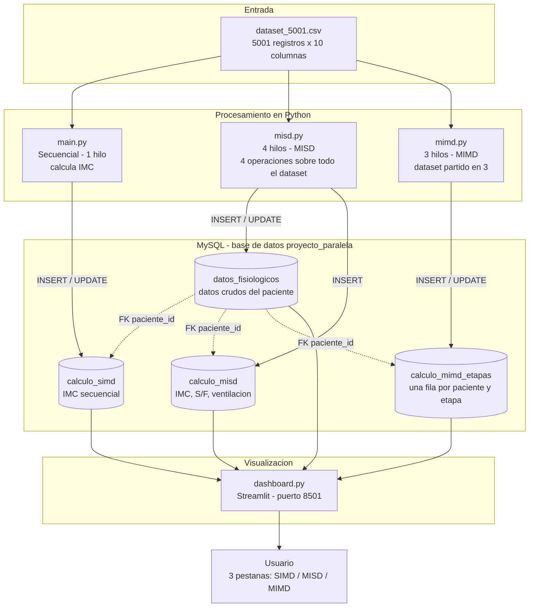
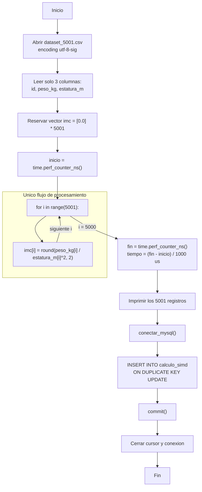
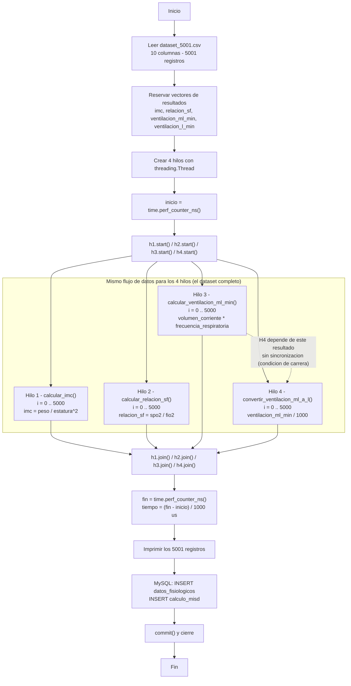
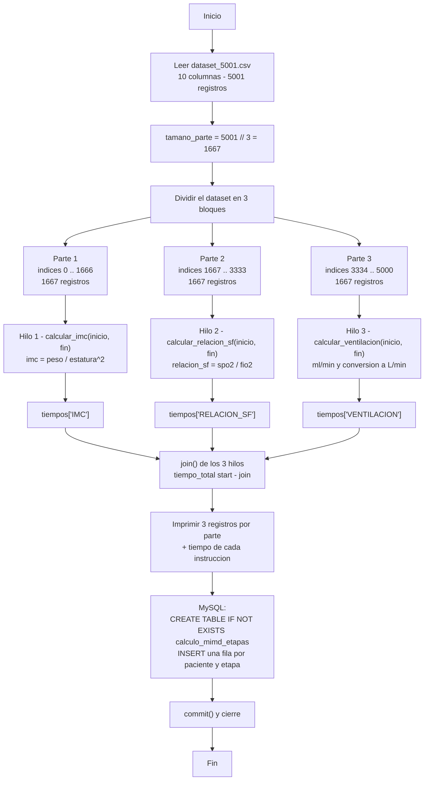
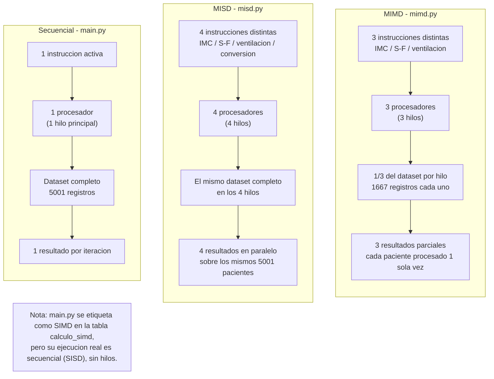
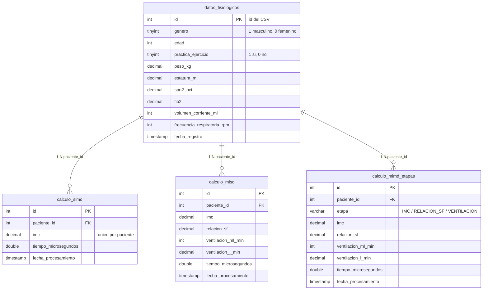
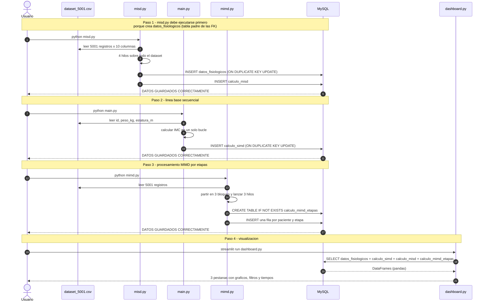

# Diagramas del proyecto

Diagramas que explican el funcionamiento del programa y las tres arquitecturas de
procesamiento empleadas. Están escritos en **Mermaid**, por lo que GitHub los renderiza
directamente en este mismo archivo.

Cada diagrama tiene además su fuente en un archivo `.mmd` para poder editarlo o exportarlo.

| # | Diagrama | Archivo | Qué muestra |
|---|---|---|---|
| 1 | Arquitectura general | [`01-arquitectura-general.mmd`](01-arquitectura-general.mmd) | Flujo completo: CSV → scripts → MySQL → dashboard |
| 2 | Flujo de `main.py` | [`02-flujo-main.mmd`](02-flujo-main.mmd) | Procesamiento secuencial del IMC |
| 3 | Flujo de `misd.py` | [`03-flujo-misd.mmd`](03-flujo-misd.mmd) | 4 hilos con 4 instrucciones sobre el mismo dataset |
| 4 | Flujo de `mimd.py` | [`04-flujo-mimd.mmd`](04-flujo-mimd.mmd) | Dataset partido en 3 y una instrucción por bloque |
| 5 | Comparación de arquitecturas | [`05-comparacion-arquitecturas.mmd`](05-comparacion-arquitecturas.mmd) | SISD vs MISD vs MIMD lado a lado |
| 6 | Modelo de datos | [`06-modelo-datos.mmd`](06-modelo-datos.mmd) | Tablas, columnas y claves foráneas |
| 7 | Secuencia de ejecución | [`07-secuencia-ejecucion.mmd`](07-secuencia-ejecucion.mmd) | Orden en que se ejecutan los scripts y el dashboard |

También hay una versión en imagen de cada diagrama (PNG a 2x) en la carpeta
[`img/`](img/), útil para pegar en informes o presentaciones.

---

## 1. Arquitectura general

El dataset es la única entrada. Los tres scripts lo leen de forma independiente y cada uno
escribe en su propia tabla de resultados. El dashboard solo lee de MySQL, nunca del CSV, y
une las tablas por la clave foránea `paciente_id`.



---

## 2. Flujo de `main.py` (secuencial)

Un solo hilo recorre los 5001 registros. El cronómetro envuelve únicamente el bucle de
cálculo: la carga del CSV y la escritura en MySQL quedan fuera de la medición.



---

## 3. Flujo de `misd.py` (MISD)

Los cuatro hilos leen **el mismo dataset completo** y cada uno ejecuta una instrucción
distinta. El tiempo se mide desde el primer `start()` hasta el último `join()`.



> **Detalle importante:** la línea punteada marca una dependencia real de datos. `h4`
> convierte a L/min el vector que llena `h3`, pero ambos arrancan al mismo tiempo y no hay
> `join()` intermedio, así que la conversión puede ejecutarse antes de que `h3` termine.

---

## 4. Flujo de `mimd.py` (MIMD)

Aquí se reparten **los datos y las instrucciones**: el dataset se divide en tres bloques
de 1667 registros y cada hilo aplica una operación distinta sobre su propio bloque. Cada
hilo mide su tiempo y se guarda el tiempo de la etapa en la base de datos.



---

## 5. Comparación de las arquitecturas



### Mapa arquitectura → código → tabla

| Arquitectura | Archivo | Hilos | Datos por hilo | Tabla de resultados |
|---|---|---|---|---|
| Secuencial (etiquetada SIMD) | `main.py` | 1 | 5001 registros | `calculo_simd` |
| MISD | `misd.py` | 4 | 5001 registros en cada hilo | `calculo_misd` |
| MIMD | `mimd.py` | 3 | 1667 registros por hilo | `calculo_mimd_etapas` |

---

## 6. Modelo de datos



`datos_fisiologicos` es la tabla padre: la llena `misd.py` y las otras tres tablas apuntan a
ella con `paciente_id`. Por eso, en una base vacía, `misd.py` debe ejecutarse primero.

---

## 7. Secuencia de ejecución



---

## Cómo ver o exportar los diagramas

- **GitHub**: se renderizan solos al abrir este archivo.
- **Editor de texto / VS Code**: instalar la extensión *Markdown Preview Mermaid Support*
  o abrir los `.mmd` con la extensión *Mermaid*.
- **En línea**: pegar el contenido de un `.mmd` en <https://mermaid.live> y descargar PNG o SVG.
- **Línea de comandos**:

  ```bash
  npx -y @mermaid-js/mermaid-cli -i 01-arquitectura-general.mmd -o 01-arquitectura-general.png
  ```
